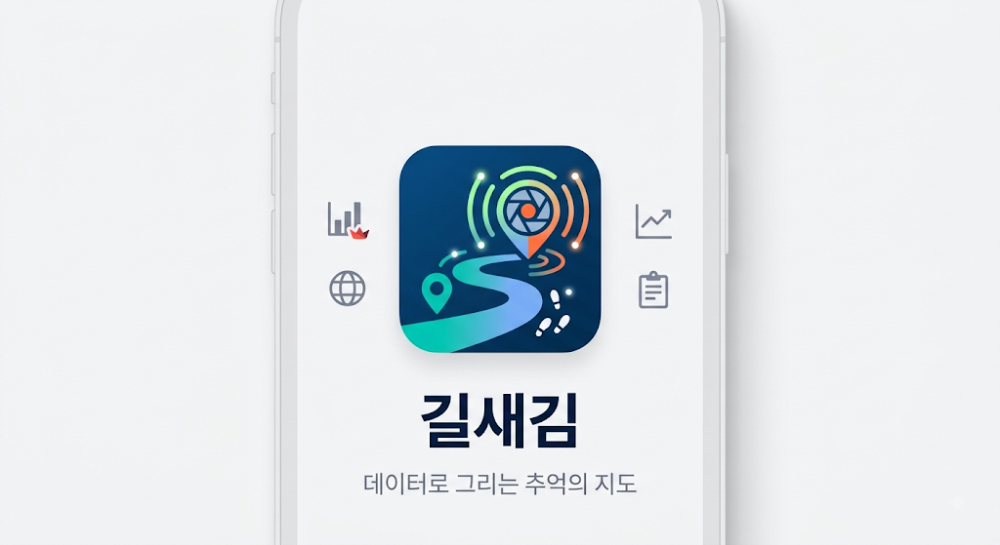
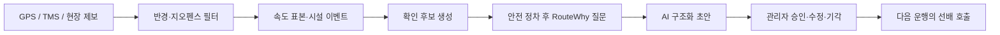

# MOVE AI · 길새김 (Gilsaegim)

운송자의 현장 판단을 GPS·제보 데이터로 포착하고, 안전 정차 후 AI 초안과 관리자 검증을 거쳐 다음 운행에 재사용하는 현장지식 서비스 프로토타입입니다.

> MOVE AI 해커톤 팀 프로젝트입니다. 이 포크는 원 저장소의 이력과 공동 작업을 보존하며, `seojeejee`의 구현 기여와 기술적 의사결정을 포트폴리오 관점에서 설명합니다.

[프로필](https://github.com/seojeejee) · [나의 기여](#나의-기여) · [시연 흐름](#대표-시연-흐름) · [실행 방법](#실행) · [원 팀 저장소](https://github.com/route-whisper/MOVE-AI)

**현재 단계:** GPS·제보·관리자 검증 흐름을 연결한 팀 프로토타입입니다. AI 구조화는 결정론적 시연 함수이며 실제 LLM·TMS 연동과 현장 효과 측정은 후속 과제입니다.

<a href="assets/gilsaegim-launch-v1.png"></a>

## 문제와 접근

물류 현장의 위험 정보는 매뉴얼보다 운송자의 경험에 남는 경우가 많습니다. 그러나 그 판단은 개인에게 머물고, 다음 운송자에게 조건과 근거가 함께 전달되기 어렵습니다.



핵심 원칙은 시스템이 운전자의 의도를 단정하지 않는 것입니다. 데이터로 감지된 행동은 먼저 `확인 후보`로 표시되고, 안전 정차 후 운전자 설명과 관리자 검증을 거쳐야 재사용 가능한 지식이 됩니다.

## 나의 기여

Git 이력에서 `seojeejee@users.noreply.github.com`으로 확인되는 구현 커밋을 기준으로 정리했습니다.

- 길새김 모바일 우선 웹 프로토타입 구현 및 공개
- Streamlit 단일 파일 배포 번들 구성
- 운송자·현장관리자 역할별 사용자 흐름 연결
- GPS/GeoJSON 위험 탐지와 시설 이벤트 파이프라인 통합
- 사진 선택·검증 및 MediaRecorder 음성 제보 흐름 구현
- 관리자 승인 전후 상태와 다음 운행 재사용 시나리오 구현
- 데모 스크립트와 배포 문서 작성

원본 프로젝트와 전체 공동 작업 이력은 [route-whisper/MOVE-AI](https://github.com/route-whisper/MOVE-AI)에서 확인할 수 있습니다.

## 설계와 구현 근거

| 현장 문제 | 설계·구현 | 확인할 자료 |
| --- | --- | --- |
| 위치 변화만으로 운전자의 의도를 알 수 없음 | 반경·지오펜스·속도 정보를 확인 후보로 처리 | [위험 판정 엔진](smart_risk_pipeline/src/risk_pipeline.py) |
| 시설 진입과 대기·이탈의 맥락이 필요함 | 시설 이벤트와 위치 이력 저장 | [시설 이벤트](smart_risk_pipeline/src/facility_engine.py), [저장 계층](smart_risk_pipeline/src/storage.py) |
| 검증되지 않은 제보가 다음 운행에 전달될 수 있음 | 관리자 승인 전후 상태와 재사용 흐름 구분 | [구현 설계](IMPLEMENTATION.md) |
| 기능을 연결한 사용자 흐름을 보여줘야 함 | 역할 선택부터 제보·검증·재사용까지 시연 순서 문서화 | [데모 스크립트](DEMO_SCRIPT.md) |

## 실제 구현 범위

- Haversine 기반 1km 반경 필터
- GeoJSON 다각형 지오펜스 판정
- 최근 20개 속도 표본 기반 이상 후보 탐지
- 시설 진입·대기·이탈 이벤트
- GPS·이벤트 SQLite 저장
- REST API와 차량 최신 위치·이력 조회
- 네트워크 없이 동작하는 SVG 지도
- 관리자 승인 전/후 UI 상태 분리
- 이미지 파일 선택, 미리보기, 8MB 제한과 형식 검증
- 브라우저 MediaRecorder 기반 음성 녹음·재생
- 마이크 권한 거부 시 데모 폴백

## 데모 경계

| 구분 | 현재 상태 |
|---|---|
| GPS 이동·ETA | 시연용 애니메이션과 결정론적 값 |
| AI 구조화 | 실제 LLM 대신 결정론적 함수 |
| 인증·권한 | 프로토타입 역할 선택 |
| TMS/FMS/CAN | 향후 실제 연동 대상 |
| 관리자 검증 | UI 상태 전환과 저장 흐름 구현 |

## 대표 시연 흐름

1. 현장관리자 또는 운송자 역할을 선택합니다.
2. 운송자가 하역장을 고르고 운행을 시작합니다.
3. 반경 → 지오펜스 → 속도 표본 → 현장 맥락 순으로 위험 후보를 계산합니다.
4. 안전 정차 후에만 RouteWhy 질문이 열립니다.
5. 운전자 답변과 사진·음성 근거가 AI 초안으로 구조화됩니다.
6. 관리자가 조건·예외·유효기간을 검토합니다.
7. 승인된 경험이 다음 운송의 `선배 호출` 카드로 재사용됩니다.

## 실행

### Streamlit 포트폴리오 데모

```powershell
python -m venv .venv
.\.venv\Scripts\Activate.ps1
python -m pip install -r requirements.txt
python -m streamlit run streamlit_app.py
```

UI를 수정한 뒤 단일 HTML 번들을 다시 만들려면:

```powershell
node build_streamlit_bundle.js
```

### Smart Risk Pipeline

```powershell
python smart_risk_pipeline/run_demo.py
python smart_risk_pipeline/run_facility_demo.py
```

로컬 API 서버:

```powershell
python server.py
```

## API

```text
GET  /api/health
POST /api/gps
POST /api/demo/risk
POST /api/demo/facility
GET  /api/vehicles/latest
GET  /api/vehicles/history?limit=80
GET  /api/facilities/status
GET  /api/facilities/events
GET  /api/risk-zones
```

## 기술 스택

- Frontend: HTML, CSS, JavaScript, mobile-first responsive UI
- Backend: Python standard library HTTP server, REST API
- Data: GPS, GeoJSON, CSV, SQLite
- Demo deployment: Streamlit Community Cloud
- Media: File API, MediaRecorder, Web Audio

## 구조

```text
.
├─ index.html / css / js       # 모바일 우선 앱 UI
├─ assets                      # 캐릭터·지도·현장 시연 이미지
├─ smart_risk_pipeline         # GPS·시설·위험 판정 엔진
├─ server.py                   # 통합 로컬 API 서버
├─ streamlit_app.py            # Streamlit 배포 진입점
└─ gilsaegim-standalone.html   # 단일 파일 데모 번들
```

세부 설계는 [IMPLEMENTATION.md](IMPLEMENTATION.md), 시연 순서는 [DEMO_SCRIPT.md](DEMO_SCRIPT.md), 이미지 출처는 [PHOTO_CREDITS.md](PHOTO_CREDITS.md)를 참고하세요.

## 다음 단계

- 실제 TMS/GPS 스트림과 인증·권한 모델 연동
- STT/VLM/LLM 기반 구조화와 근거 추적
- 승인·수정·기각 감사 로그
- 위험 후보 precision/recall 및 선행시간 평가
- 운전자 주의분산을 줄이는 안전 정차 정책의 실제 사용성 검증

## 출처와 권리

- Upstream: [route-whisper/MOVE-AI](https://github.com/route-whisper/MOVE-AI)
- 이 포크는 upstream의 커밋 이력과 작성자 정보를 유지합니다.
- upstream에 별도 라이선스가 명시되어 있지 않으므로, 코드를 재사용하려면 권리자에게 먼저 확인하세요.
